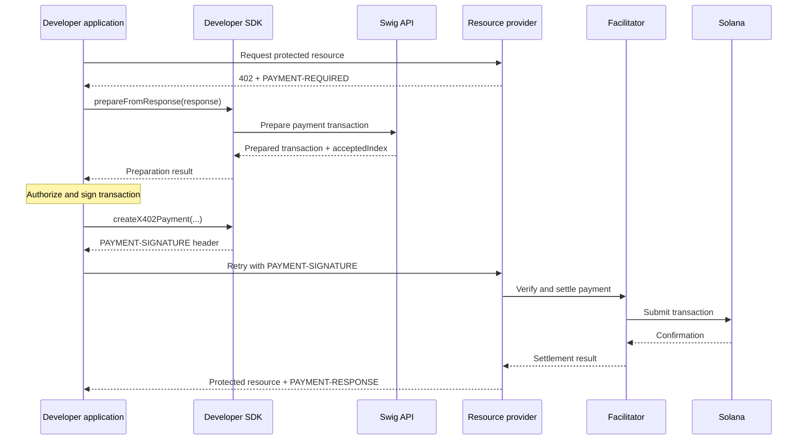

Use a Swig wallet to pay for APIs and other HTTP resources that return
`402 Payment Required`. Pass the response to the Developer SDK to prepare a
payment transaction. Your application authorizes and signs the payment, then
sends the original request again with a `PAYMENT-SIGNATURE` header. The resource
provider's facilitator verifies and settles the payment.

## How the payment flow works



The Swig API prepares the payment transaction but does not submit or settle it.
Send the payment header back to the resource provider for facilitator
settlement. This flow does not use the Swig paymaster.

## Before you begin

You need:

- a configured `SwigClient` (or `WalletClient` in Rust) and an existing Swig wallet
- an Ed25519 or secp256r1 authority assigned to a role permitted to invoke the
  token program and spend the selected mint
- an x402 version 2 resource offering the `exact` payment scheme on the wallet's
  Solana mainnet or devnet network
- the wallet's canonical associated token account, already created and funded
  with enough of the requested token
- the recipient's canonical associated token account, already created for the
  `payTo` owner and mint
- a legacy SPL Token mint or a Token-2022 mint with no extensions; Token-2022
  token accounts may have no extensions or only `ImmutableOwner`
- a facilitator that supports Swig smart-wallet verification

Other Token-2022 mint and token-account extensions are not supported.

For passkey payments, the facilitator must also permit Solana's secp256r1
signature-verification program.

## Pay for a resource

These examples use an Ed25519 requester and assume your application provides
the Swig wallet identifiers, requester public key, resource URL, and signing
callback.

In TypeScript and Python, `signTransaction` / `sign_transaction` receives the
base64 serialized transaction and prepared record, then returns the signed
base64 transaction.

Rust uses the configured `wallet` from
[Rust configuration](/developer-sdk/integration-paths#rust), with
`swig_config_address` and `requester_public_key` as native `Pubkey` values.
Its application-provided `sign_transaction` receives `&PreparedTransaction`
and returns a requester-signed `VersionedTransaction`, rather than base64.
The application signs only its required slots, leaving the fee-payer signature
empty for the facilitator to add at settlement.
See [Signers](/developer-sdk/signers) for native signing.

The application approves the recipient, mint, amount, and network, then reviews
the prepared instructions, accounts, and freshness before signing. The
transaction must use the selected offer's fee payer, distinct from the requester.

The examples request a resource with `GET` and no additional headers. In your
integration, repeat the original request with the same URL, method, body, and
existing headers, adding the generated `PAYMENT-SIGNATURE` header.
The Rust example uses a separate `reqwest::Client` without the Swig API key and
with redirects disabled for both resource requests.

<CodeGroup dropdown>

```typescript TypeScript
import {
  SwigClient,
  createX402Payment,
} from '@swig-wallet/developer-sdk';
import { signPreparedTransaction } from '@swig-wallet/developer-sdk/signers';

const swig = new SwigClient({
  apiKey: process.env.SWIG_API_KEY!,
  network: 'devnet',
});

const wallet = swig.wallets.use({
  swigConfigAddress,
  walletAddress,
  requesterAuthority: {
    ed25519: { publicKey: developerPublicKey },
  },
});

const challenge = await fetch(resourceUrl);
const prepared = await wallet.x402.prepareFromResponse(challenge);

const signed = await signPreparedTransaction(
  prepared.preparedTransaction,
  { signTransaction },
);

const payment = createX402Payment(prepared, signed);

const paidResponse = await fetch(resourceUrl, {
  headers: payment.paymentSignatureHeaders,
});

if (!paidResponse.ok) {
  throw new Error(`Paid request failed: ${paidResponse.status}`);
}

const resource = await paidResponse.json();
const paymentResponse = paidResponse.headers.get('PAYMENT-RESPONSE');
```

```python Python
import asyncio
import os

import httpx

from swig_developer_sdk import SwigClient, create_x402_payment
from swig_developer_sdk.signers import sign_prepared_transaction

swig = SwigClient(
    api_key=os.environ["SWIG_API_KEY"],
    network="devnet",
)

wallet = swig.wallets.use(
    swig_config_address,
    requester_authority={
        "ed25519": {"publicKey": developer_public_key},
    },
)

async def main() -> None:
    async with httpx.AsyncClient() as http:
        challenge = await http.get(resource_url)
        prepared = await wallet.x402.prepare_from_response(challenge)

        signed = await sign_prepared_transaction(
            prepared.prepared_transaction,
            sign_transaction=sign_transaction,
        )

        payment = create_x402_payment(prepared, signed)

        paid_response = await http.get(
            resource_url,
            headers=payment.payment_signature_headers,
        )
        paid_response.raise_for_status()

        resource = paid_response.json()
        payment_response = paid_response.headers.get("PAYMENT-RESPONSE")


if __name__ == "__main__":
    asyncio.run(main())
```

```rust Rust
use reqwest::Client;
use swig_developer_sdk::{
    x402::{create_x402_payment, parse_payment_required},
    PrepareX402PaymentArgs, WalletAuthority,
};

let http = Client::builder()
    .redirect(reqwest::redirect::Policy::none())
    .build()?;

let challenge = http.get(&resource_url).send().await?;
if challenge.status().is_redirection() {
    return Err("resource redirect requires a new payment flow".into());
}
let payment_required = parse_payment_required(challenge.status(), challenge.headers())?;

let prepared = wallet
    .prepare_x402_payment(PrepareX402PaymentArgs {
        swig_config_address,
        requester_authority: WalletAuthority::Ed25519 {
            public_key: requester_public_key,
        },
        payment_required,
        accepted_index: None,
    })
    .await?;

let signed_transaction = sign_transaction(&prepared.prepared_transaction).await?;

let payment = create_x402_payment(
    prepared.payment_required,
    prepared.accepted_index,
    signed_transaction,
)?;
let response = http
    .get(&resource_url)
    .headers(payment.payment_signature_headers)
    .send()
    .await?;
if response.status().is_redirection() {
    return Err("resource redirected after payment submission".into());
}
let paid_response = response.error_for_status()?;
```

</CodeGroup>

For secp256r1, apply the authority-signing flow from
[Signers](/developer-sdk/signers), then add any application-owned outer Solana
signatures. Keep the signed transaction paired with the exact preparation that
produced it. In Rust, `create_x402_payment` takes that preparation's
`payment_required` and `accepted_index` alongside the signed transaction.

The resource response exposes its body and any `PAYMENT-RESPONSE` header.
Keep payment headers and signed transactions out of logs.

Payment settlement and the resource response are separate. A failed or missing
response can occur after settlement. The original payment attempt remains
unresolved until reconciled with the resource service. The SDK does not perform
that reconciliation.

Redirects stop the Rust example. For an initial redirect, approve the destination
and fetch its own challenge before authorizing payment. For a paid-request
redirect, resolve the original payment outcome before authorizing another
payment. Never forward the existing payment header to the redirected URL.
Marking a header sensitive does not prevent Reqwest from forwarding it, and
`error_for_status()` does not reject `3xx`.

## Choose a payment offer

Each entry in the challenge's `accepts` array is a payment offer. When the index
is omitted, Swig selects the first supported offer using the `exact` scheme on
the wallet's Solana network. The result preserves that offer's position in the
original `accepts` array.

In Rust, `parse_payment_required` requires HTTP 402 and one valid
`PAYMENT-REQUIRED` header. It returns `PaymentRequiredV2`, preserving every
offer's position. Supported offers are `PaymentRequirement::ExactSvm`; other
offers remain `PaymentRequirement::Unsupported`.

Pass an index when your application has already chosen an offer:

<CodeGroup dropdown>

```typescript TypeScript
const prepared = await wallet.x402.prepareFromResponse(challenge, {
  acceptedIndex: 2,
});
```

```python Python
prepared = await wallet.x402.prepare_from_response(
    challenge,
    accepted_index=2,
)
```

```rust Rust
use swig_developer_sdk::{PrepareX402PaymentArgs, WalletAuthority};

let prepared = wallet
    .prepare_x402_payment(PrepareX402PaymentArgs {
        swig_config_address,
        requester_authority: WalletAuthority::Ed25519 {
            public_key: requester_public_key,
        },
        payment_required,
        accepted_index: Some(2),
    })
    .await?;
```

</CodeGroup>

An explicit index must identify a supported `exact` offer on the wallet's
Solana network. Swig returns an error instead of falling back to another offer
when the selected offer is incompatible.

Rust's `accepted_index: None` selects the first eligible offer on the client's
network. Parsing can preserve offers that hosted preparation cannot use.
Preparation supports version 2 `exact` offers with Ed25519 or secp256r1
requesters. It requires a canonical positive `u64` amount, an integer timeout
fitting `u32`, a memo of at most 256 bytes, and any supplied last-valid block
height fitting `u64`. Automatic selection skips ineligible offers. These checks
establish compatibility, not purchase authorization.

## Understand the prepared result

`prepareFromResponse()` / `prepare_from_response()` returns the fields below.
Rust's `prepare_x402_payment` returns them as `X402PaymentPreparation`:

| Field | Description |
| :--- | :--- |
| `preparedTransaction` / `prepared_transaction` | The unsigned Swig payment transaction and any embedded signature requests |
| `paymentRequired` / `payment_required` | The validated x402 payment challenge used during preparation |
| `acceptedIndex` / `accepted_index` | The selected offer's position in the original `accepts` array |

Rust's `prepared_transaction` is a `PreparedTransaction` containing a native
`VersionedTransaction`. `prepare_x402_payment` sends its POST once. The examples
perform one paid resource retry.

After signing, `createX402Payment()` / `create_x402_payment()` returns:

| Field | Description |
| :--- | :--- |
| `paymentPayload` / `payment_payload` | The x402 payment payload containing the selected offer and signed transaction |
| `paymentSignatureHeaders` / `payment_signature_headers` | A `PAYMENT-SIGNATURE` header ready to merge into the resource retry |

Rust's `create_x402_payment` checks the selected offer, transaction structure,
and encoded size limits (1,232 transaction bytes and 8,000 header bytes). It
does not verify signatures or transaction intent. The facilitator verifies and
settles the payment when the paid request reaches the resource provider.

## Run the complete example

<Card
  title="x402 Payment Example"
  icon="code"
  href="https://github.com/anagrambuild/swig-developer-sdk/tree/main/typescript/examples/x402"
>
  Run a resource provider, facilitator, and Swig payer through the complete
  challenge, preparation, signing, settlement, and paid-resource flow.
</Card>

## What to read next

<CardGroup cols={2}>
  <Card title="Signers" icon="signature" href="/developer-sdk/signers">
    Connect application-owned Ed25519 keys or passkeys.
  </Card>
  <Card title="Add Roles" icon="user-shield" href="/developer-sdk/add-roles-and-permissions">
    Assign a requester authority to an existing Swig wallet.
  </Card>
  <Card title="Transfer SOL and Tokens" icon="arrow-right-arrow-left" href="/developer-sdk/transfers-and-swaps">
    Prepare ordinary wallet transfers outside the x402 flow.
  </Card>
  <Card title="Transaction API" icon="code" href="/developer-api/transactions">
    Integrate with Swig's transaction endpoints directly.
  </Card>
</CardGroup>
